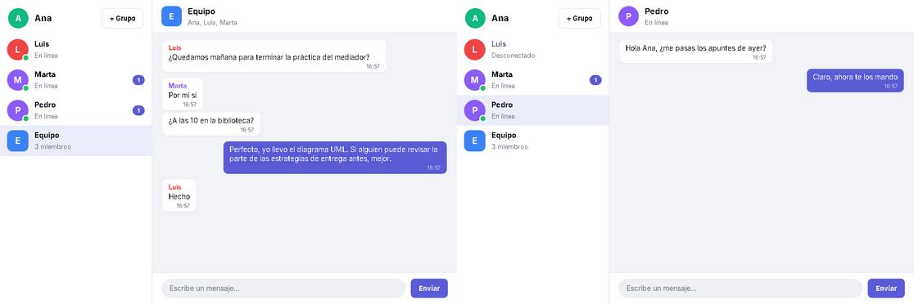
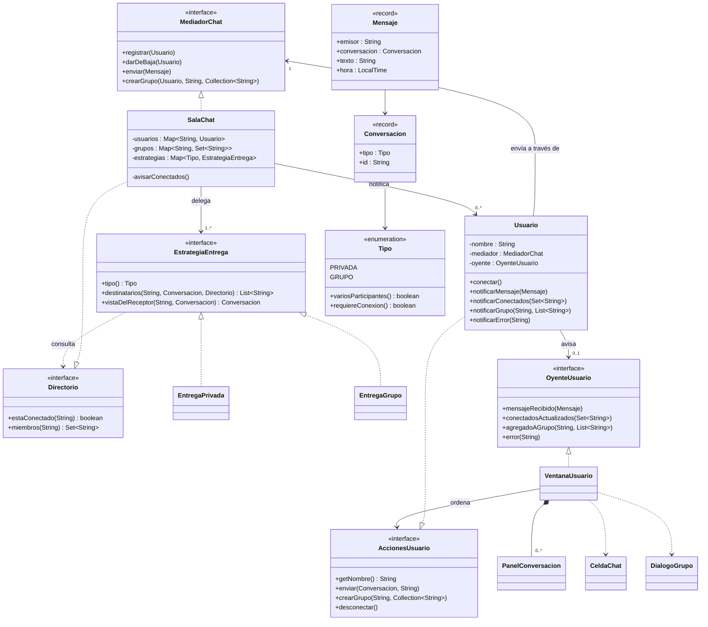

# Chat en tiempo real con el patrón Mediador (Java)

Chat de escritorio en Java + Swing, sin librerías externas. Cada usuario tiene su propia ventana. Los usuarios nunca se comunican directamente entre sí: todo pasa por un **mediador**.



## Requisitos del enunciado y dónde se cumplen

| Requisito | Cómo se cumple | Clases implicadas |
|---|---|---|
| Comunicación en tiempo real entre varios usuarios | Al pulsar Intro, el mensaje aparece al instante en la ventana del destinatario | `PanelConversacion` → `Usuario` → `SalaChat` |
| El texto aparece en la ventana del usuario con el que se habla | El mediador entrega el mensaje al destinatario y este lo muestra en el chat correspondiente | `SalaChat`, `Usuario`, `VentanaUsuario` |
| a) Conversaciones independientes con varios usuarios a la vez | Cada conversación tiene su propio panel y la lista muestra los mensajes sin leer de cada una | `VentanaUsuario`, `PanelConversacion`, `EntregaPrivada` |
| b) Conversaciones de grupo | El mensaje llega a todos los miembros del grupo menos al emisor | `SalaChat.crearGrupo`, `EntregaGrupo` |
| Uso del patrón Mediador | Los usuarios solo conocen al mediador | `MediadorChat`, `SalaChat`, `Usuario` |

## Cómo se usa

- **Abrir un chat:** haz clic en un usuario o en un grupo de la lista de la izquierda.
- **Enviar un mensaje:** escríbelo abajo y pulsa **Intro** o el botón **Enviar**.
- **Crear un grupo:** pulsa **+ Grupo**, escribe el nombre y marca con un clic a los miembros. Al arrancar ya existe el grupo de ejemplo «Equipo» (Ana, Luis y Marta).
- **Mensajes sin leer:** el número junto a cada chat indica los mensajes pendientes, y el título de la ventana muestra el total.
- **Desconectarse:** al cerrar la ventana de un usuario, este se desconecta. Los demás lo ven como «Desconectado» y no pueden escribirle hasta que vuelva.

## Compilar y ejecutar

Requiere JDK 17 o superior.

**Desde la terminal:**

```bash
javac -encoding UTF-8 -d out $(find src -name "*.java")
java -cp out chat.Main                 # Ana, Luis, Marta y Pedro
java -cp out chat.Main Alicia Bruno    # otros nombres
```

**Desde IntelliJ IDEA:** abre la carpeta del proyecto, comprueba que el SDK sea Java 17 o superior (*File → Project Structure → Project*) y ejecuta `Main` con la flecha verde junto a `main`.

## Estructura

```
chat-mediador-minimo/
├── README.md
├── captura.png                    Captura de la aplicación
├── docs/
│   ├── diagrama-uml.png           Diagrama de clases (imagen)
│   └── Chat.puml           Diagrama de clases generado por PlantUML Parser
└── src/chat/
    ├── Main.java                  Crea el mediador y una ventana por usuario
    ├── modelo/
    │   ├── Conversacion.java      Conversación privada o de grupo; incluye el enum Tipo,
    │   │                          con las características de cada tipo
    │   └── Mensaje.java           Mensaje inmutable: emisor, conversación, texto y hora
    ├── mediador/
    │   ├── MediadorChat.java      Mediator: interfaz del mediador
    │   ├── SalaChat.java          ConcreteMediator: conoce a usuarios y grupos y reparte los mensajes
    │   ├── Directorio.java        Consultas que las estrategias hacen a la sala
    │   ├── EstrategiaEntrega.java Strategy: decide a quién llega un mensaje
    │   ├── EntregaPrivada.java    ConcreteStrategy: conversación uno a uno
    │   └── EntregaGrupo.java      ConcreteStrategy: conversación de grupo
    ├── usuarios/
    │   ├── Usuario.java           Colleague: solo conoce al mediador
    │   ├── AccionesUsuario.java   Órdenes que la ventana puede dar al usuario
    │   └── OyenteUsuario.java     Avisos que el usuario pasa a su ventana
    └── gui/
        ├── VentanaUsuario.java    Ventana de un usuario: lista de chats y conversación abierta
        ├── PanelConversacion.java Una conversación: cabecera, mensajes y caja de texto
        ├── CeldaChat.java         Fila de la lista de chats (avatar, nombre, estado, no leídos)
        ├── DialogoGrupo.java      Diálogo para crear un grupo
        ├── Burbuja.java           Burbuja de un mensaje
        ├── Avatar.java            Círculo con la inicial y el punto de «en línea»
        └── Estilo.java            Colores, tipografía y controles comunes
```

## Patrón Mediador

| Rol | Clase | Qué hace |
|---|---|---|
| Mediator | `MediadorChat` | Define cómo se comunican los usuarios: registrarse, darse de baja, enviar y crear grupos |
| ConcreteMediator | `SalaChat` | Conoce a todos los usuarios y grupos y entrega cada mensaje a quien corresponde |
| Colleague | `Usuario` | Solo conoce al mediador; para hablar con alguien se lo pide a él |

Cada usuario solo tiene una referencia al mediador y ninguna a los demás usuarios. Gracias a eso, añadir o quitar usuarios no afecta a nadie más, y toda la lógica de comunicación está en un único sitio (`SalaChat`).

Sin el mediador, cada usuario tendría que guardar referencias a todos los demás y a todos sus grupos, y cada usuario nuevo obligaría a actualizar a los existentes. Con el mediador, esas relaciones de «muchos con muchos» se convierten en relaciones de «uno con el mediador».

### Patrón Estrategia (complemento)

Los apartados a) y b) se diferencian en **a quién** llega un mensaje. En lugar de llenar el mediador de `if (privada) … else (grupo) …`, cada caso es una estrategia:

| Rol | Clase |
|---|---|
| Strategy | `EstrategiaEntrega` |
| ConcreteStrategy | `EntregaPrivada`, `EntregaGrupo` |
| Context | `SalaChat` |

- `EntregaPrivada`: el destinatario es el otro usuario, siempre que esté conectado.
- `EntregaGrupo`: los destinatarios son los miembros conectados del grupo menos el emisor, y solo si el emisor pertenece al grupo.

`SalaChat` elige la estrategia según el tipo de conversación. Un tipo nuevo, por ejemplo un mensaje a todos, sería otra estrategia, sin modificar el mediador.

## Diagrama de clases

Versión completa en imagen: [`docs/diagrama-uml.png`](docs/diagrama-uml.png). Versión simplificada:



`Burbuja`, `Avatar` y `Estilo` (aspecto visual) no aparecen en la versión simplificada; están en la imagen completa.

## Principios SOLID

| Principio | Cómo se cumple |
|---|---|
| **S**: responsabilidad única | `Usuario` solo hace de colega y no sabe nada de ventanas. `SalaChat` coordina; decidir los destinatarios lo hacen las estrategias. En la interfaz, cada clase pinta una sola cosa: `VentanaUsuario` organiza la ventana, `PanelConversacion` una conversación, `CeldaChat` una fila de la lista, `DialogoGrupo` el diálogo de grupo y `Burbuja`/`Avatar` sus elementos. |
| **O**: abierto/cerrado | Nadie pregunta «¿es un grupo?». El mediador delega en una estrategia por tipo. La interfaz pregunta por **características** del tipo (`variosParticipantes()` y `requiereConexion()`), no por el tipo en sí. Un tipo nuevo de conversación solo necesita declarar sus características y tener su estrategia. |
| **L**: sustitución de Liskov | `EntregaPrivada` y `EntregaGrupo` son intercambiables como `EstrategiaEntrega`. Cualquier implementación de `MediadorChat` serviría a los usuarios. |
| **I**: segregación de interfaces | Interfaces pequeñas y con un propósito: `Directorio` (dos consultas para las estrategias), `OyenteUsuario` (los avisos a la ventana) y `AccionesUsuario` (las órdenes de la ventana). |
| **D**: inversión de dependencias | `Usuario` depende de `MediadorChat`, `SalaChat` de `EstrategiaEntrega`, las estrategias de `Directorio` y la ventana de `AccionesUsuario`. Ninguna depende de clases concretas. Las clases concretas solo se eligen en `Main`. |

## Recorrido de un mensaje

1. Ana escribe en el chat con Luis y pulsa Intro. `PanelConversacion` le pasa el texto a `Usuario.enviar(...)`.
2. `Usuario` crea el `Mensaje` y llama a `mediador.enviar(mensaje)`.
3. `SalaChat` elige la estrategia del tipo de conversación (`EntregaPrivada`), que devuelve los destinatarios: `[Luis]`.
4. `SalaChat` llama a `luis.notificarMensaje(...)`, y también a `ana.notificarMensaje(...)` como confirmación.
5. Cada `Usuario` avisa a su ventana (`OyenteUsuario`), que muestra la burbuja en el chat correspondiente.

En un grupo el recorrido es el mismo, pero en el paso 3 `EntregaGrupo` devuelve a todos los miembros conectados menos al emisor.

## Casos que controla el mediador

`SalaChat` rechaza las operaciones no válidas y avisa al usuario con un mensaje de error:

- Enviar un mensaje a un usuario desconectado.
- Enviar un mensaje a un grupo del que no formas parte.
- Conectar a un usuario con un nombre que ya existe.
- Crear un grupo sin nombre, con un nombre repetido o sin ningún otro miembro.

## Limitaciones

- Todos los usuarios se ejecutan en el mismo programa, cada uno en su propia ventana; no hay comunicación por red. Para usarlo entre ordenadores distintos bastaría con otra implementación de `MediadorChat` basada en sockets, sin cambiar los usuarios.
- Los mensajes no se guardan: al cerrar el programa se pierden.